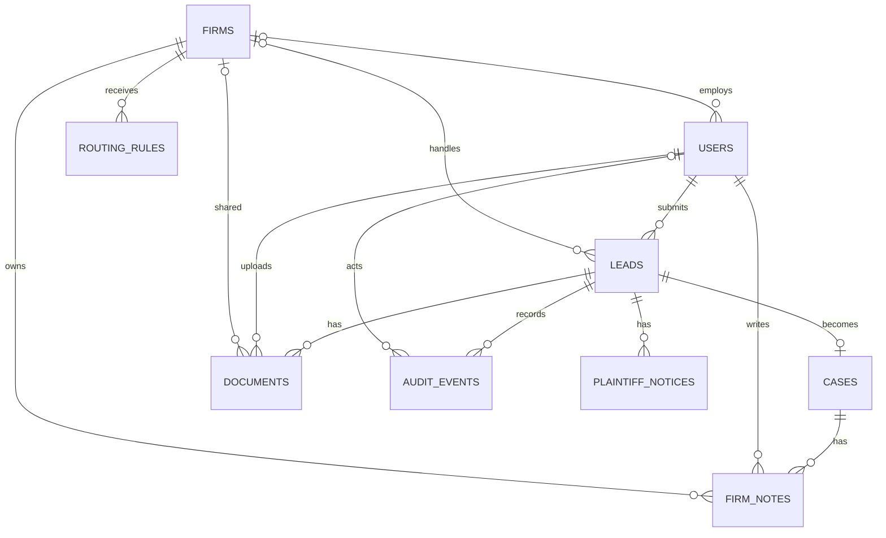

# Data model

The [workflow rules](workflow-rules.md) define the states and permissions.

## Records

These are the logical fields we need for the workflows.

| Record | Fields and relationships |
| --- | --- |
| `users` | <ul><li>ID</li><li>Name</li><li>Email</li><li>Role</li><li>Firm ID for attorneys and paralegals. Each staff account belongs to one firm.</li></ul> |
| `firms` | <ul><li>ID</li><li>Name</li></ul> |
| `leads` | <ul><li>ID</li><li>Plaintiff user ID</li><li>Name and email as submitted</li><li>Category</li><li>Region</li><li>Description</li><li>Lead status</li><li>Current firm ID. Pending and closed leads have no current firm.</li><li>Submission time</li></ul> |
| `cases` | <ul><li>ID</li><li>Unique lead ID. The linked lead provides the plaintiff and current firm.</li><li>Progress status</li><li>Creation time</li></ul> |
| `documents` | <ul><li>ID</li><li>Lead ID. The case reads documents through the lead, including plaintiff PDFs uploaded before acceptance.</li><li>Filename</li><li>Private storage key</li><li>Uploader user ID</li><li>Sharing firm ID for firm uploads</li><li>Upload time</li></ul> |
| `firm_notes` | <ul><li>ID</li><li>Case ID</li><li>Author user ID</li><li>Owning firm ID. Ownership stays with the firm that wrote the note.</li><li>Note text</li><li>Creation time</li></ul> |
| `routing_rules` | <ul><li>Category</li><li>Region</li><li>Destination firm ID. The proposed seed data has one destination per category and region pair.</li></ul> |
| `audit_events` | <ul><li>ID</li><li>Lead ID. Case events appear in the history of the linked lead.</li><li>Event type</li><li>Actor user ID or System</li><li>Timestamp</li><li>Relevant before and after values</li></ul> |
| `plaintiff_notices` | <ul><li>ID</li><li>Lead ID. The lead identifies the recipient.</li><li>Message. Plaintiffs can see the reassignment or closure notice when they return.</li><li>Creation time</li></ul> |

## How the model handles changes

- **Accept a lead.** Lock the lead for the duration of the transaction. Check that it still awaits review and that the actor belongs to its current firm. Change the lead to Accepted, create the case, and add the audit event in that transaction. The unique constraint on `cases.lead_id` enforces at most one case per lead.
- **Reassign a case.** Update the current firm on the lead and save the audit event and any required notice in one transaction. The case keeps its ID and progress. A single assignment field keeps the lead and case in sync.
- **Check document and note access.** Use the current assignment to check whether the firm can open the record. Use the stored sharing firm or note owner to check which documents and notes it can see. After reassignment, the receiving firm can access plaintiff uploads and its own firm's content. The plaintiff keeps access to PDFs shared with them.
- **Route a new lead.** Look up the category and region at submission. A match assigns the lead to that firm. An unmatched lead goes to the admin queue. A manual assignment changes that lead's assignment only.

## Decisions and tradeoffs

| Choice | Tradeoff |
| --- | --- |
| PostgreSQL | Supports locking one lead during acceptance while other leads can still be updated. It requires a running database service. |
| Docker Compose for local PostgreSQL | Gives reviewers the same database setup from a fresh checkout. It adds Docker as a prerequisite for the default setup. |
| Separate lead and case records | Preserves the original intake and gives case progress its own lifecycle. Reading both together requires a join. |
| One current assignment on the lead | Keeps reassignment to one field update. Case queries join the lead when they need the current firm. |
| Seeded routing by category and region | Gives each pair a predictable destination. Supporting multiple eligible firms would require a selection policy such as priority or round-robin. |
| Current state with append-only audit events | The app reads current state directly and admins can inspect changes in order. Each workflow action must write its audit event alongside the update. Full snapshots would use more storage, and event sourcing would add event replay and versioning. |
| Separate plaintiff notices | Keeps plaintiff-facing messages easy to query and gives them a separate access rule from the admin audit history. Each action that requires a notice writes one alongside the audit event. |

The [decision log](decisions.md) tracks remaining product questions, including case reopening and routing tie-breaks.
