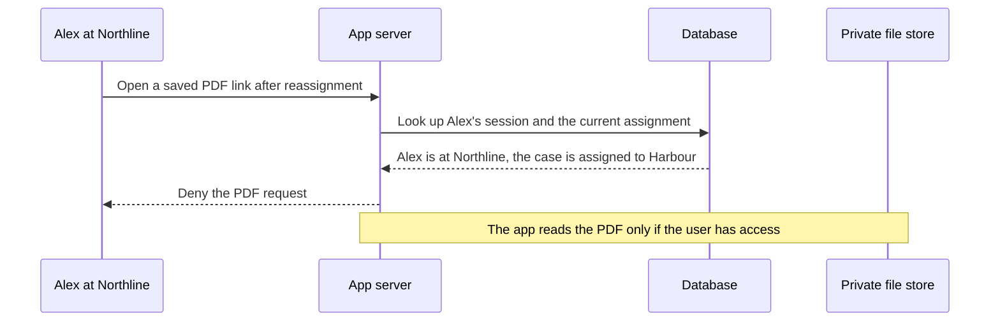

# Identity and access

## Decisions and tradeoffs

| Decision | What we chose | Tradeoff |
| --- | --- | --- |
| Demo sign-in | Create demo accounts ahead of time for two plaintiffs, staff at two firms, and an admin. Reviewers can sign in as different people to try the access rules. | Seeded accounts make local setup easy. A managed sign-in provider could handle registration and account recovery, but would add setup. |
| Sessions | Keep sessions on the server. The browser sends a cookie with a session ID, and the server uses it to find the user and check their current role and firm. | The server looks up the session on each request, which lets it end a session immediately. A signed token can skip that lookup, but ending it early or keeping its role and firm up to date takes extra work. |
| Firm access | Assign work to a firm. Its attorneys and paralegals can work on the same case. The current firm can see plaintiff uploads and the PDFs and notes its own staff added. The plaintiff keeps access to PDFs shared with them after reassignment. | Colleagues can pick up each other's cases. Giving access to specific staff on each case would offer more control, but someone would have to keep those assignments up to date. |
| Admin access | Admins can manage assignments and review audit history. Authorized admins can read firm notes. PDF access is limited to the plaintiff and eligible firm staff. | This limits who can read sensitive PDFs. Admins who need to investigate a document issue would have to work with someone who can open it. |
| Where we check access | Use the same server-side rules for lists, search, record details, updates, and PDF requests. Check the user's role and their relationship to the record. | Each route has to use the shared checks. Database row-level security would add another layer, with a second set of rules to configure and test. |
| PDF storage | Keep PDFs in a private folder for the local demo. Store each file's details and storage key in the database. | A private folder is simple to set up, but files and database records have to stay in sync. Storing PDFs in the database would let us save both together and would make backups larger. Private object storage would let multiple servers share files, with an extra service to set up. |
| Opening PDFs | Serve files through the app. Before sending a PDF, the server checks who is asking and whether they still have access. | The app handles the download traffic. A signed link would let storage serve the file directly, but someone at the former firm could still use a link issued before reassignment until it expires. |
| An open page after reassignment | Recheck the session and selected record when the user returns to the tab. Clear the record, refresh the list, and explain the change if a request reports lost access. Block actions while checking; keep drafts if the check fails because the server is unreachable. | This adds requests when the user returns. A page left open stays unchanged until the next request or focus check. Polling or live updates would detect changes sooner and add ongoing traffic and complexity. |

## Saved link after reassignment

