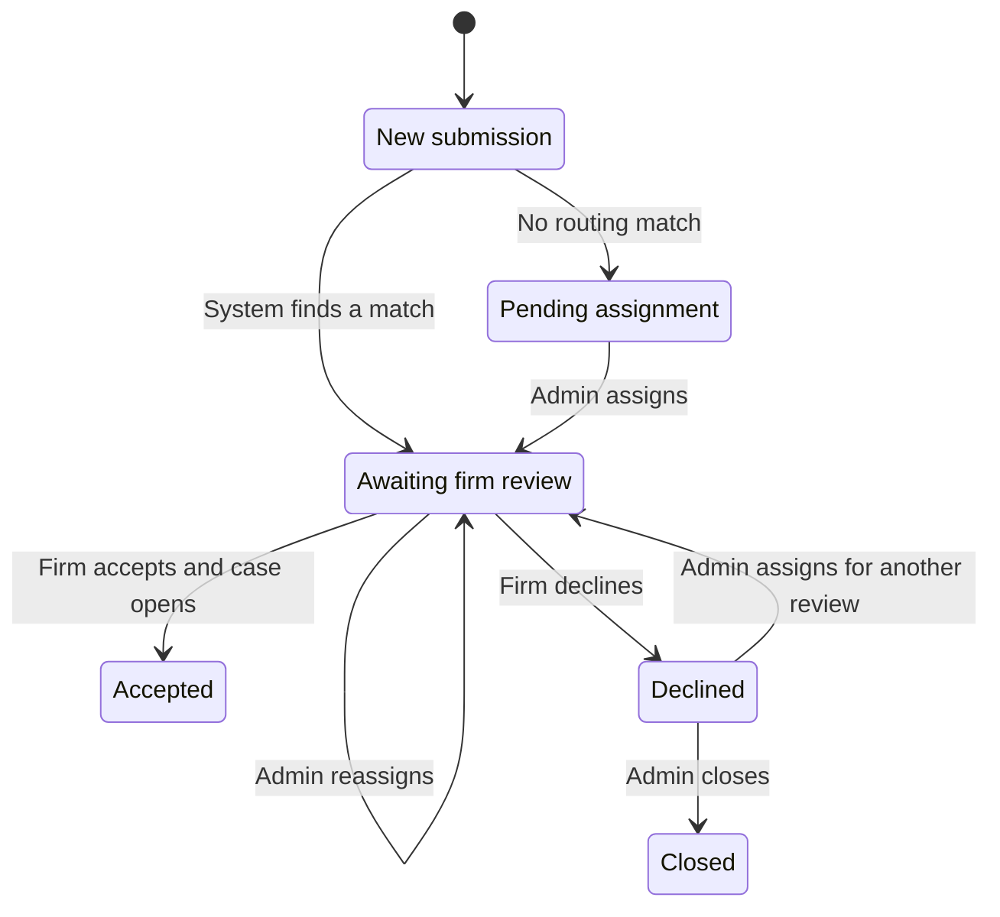
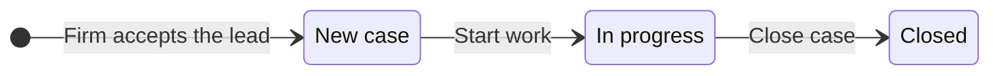
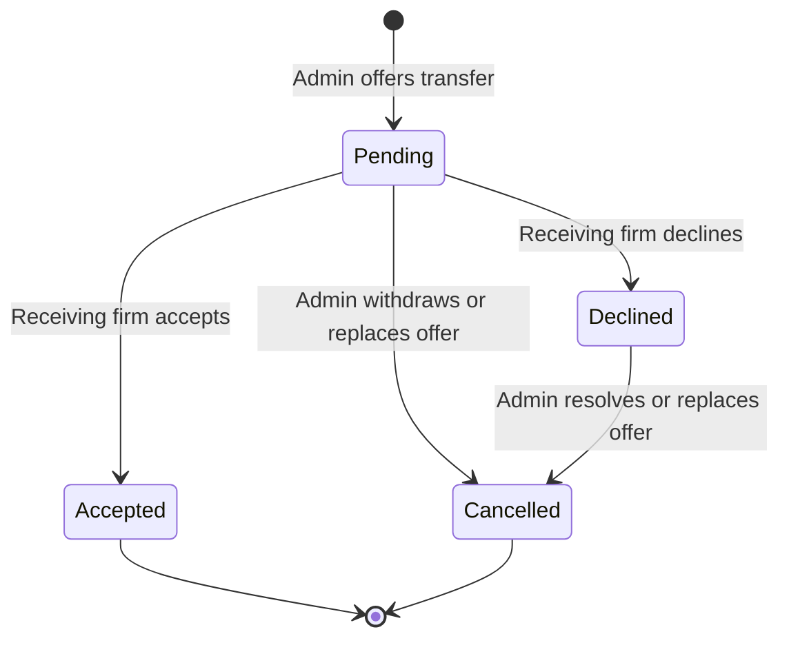

# Workflow rules

This document defines the lead and case states, who can change them, and who can access each record. See the [PRD](requirements.md) for acceptance criteria and the [decision log](decisions.md) for open questions.

## Lead state machine

| Current state | Action | Actor | Next state | What changes |
| --- | --- | --- | --- | --- |
| New submission | Route to a matching firm | System | Awaiting firm review | The app assigns the lead to one firm. It appears in that firm's active inbox. |
| New submission | Find no routing match | System | Pending assignment | The lead has no assigned firm and appears in the admin queue. |
| Pending assignment | Assign to a firm | Admin | Awaiting firm review | The lead appears in the assigned firm's active inbox. |
| Awaiting firm review | Reassign to another firm | Admin | Awaiting firm review | The lead moves to the new firm's active inbox. The previous firm loses access. |
| Awaiting firm review | Accept | Assigned firm staff | Accepted | The app creates one linked case. The lead moves from the active inbox to Accepted, where staff can open the case from the lead. |
| Awaiting firm review | Decline | Assigned firm staff | Declined | Staff confirm the decline. The lead leaves the active inbox and enters the admin queue. The firm can still read the lead while assigned. |
| Declined | Assign for another review | Admin | Awaiting firm review | The lead returns to the active inbox of the selected firm. The admin can assign it back to the same firm to correct a mistaken decline. The original decline stays in the audit history. |
| Declined | Close without assigning | Admin | Closed | The assignment ends. The lead remains visible to the plaintiff and admins. |

- The app checks the current state and assignment before accepting or declining. A second attempt to accept the same lead can't create another case.
- A firm can act on a lead only while it is assigned and awaiting firm review. Admin assignment is the path back to review after decline.
- An accepted lead stays Accepted as its case progresses. An admin moves it through case reassignment, which transfers the case and its linked lead together.

### Plaintiff status and notices

- A declined lead appears to the plaintiff as **Awaiting admin review** while the admin decides what to do.
- When an admin reassigns or closes a lead, the plaintiff sees a persistent in-app notice on return. For closure, the notice explains that the request was closed without placement at a firm.
- Notifications outside the app are out of scope.

## Case state machine

The agreed case statuses are **New case**, **In progress**, and **Closed**. The progress and closure transitions below are proposed defaults.

An admin can offer a case transfer in any state. The current firm keeps managing the case until the receiving firm accepts. The case keeps its identity and progress.

| Current state | Action | Actor | Next state | What changes |
| --- | --- | --- | --- | --- |
| Case creation | Accept the linked lead | Assigned firm staff | New case | The new case starts with the same plaintiff and assigned firm as the lead. PDFs already uploaded by the plaintiff are available on the case. |
| New case | Start work | Assigned firm staff | In progress | The new status is visible to the plaintiff. |
| In progress | Close the case | Assigned firm staff | Closed | The case stays available to users with access. The linked lead stays Accepted. |
| Any case status | Offer a transfer | Admin | Same status | The receiving firm reviews a lead in its inbox. The current firm retains ownership. Acceptance moves the existing case and lead together; decline returns the offer to admin. |

See [case closure and reopening](decisions.md#case-closure-and-reopening) for the remaining questions about Closed cases.

## Case transfer review

- A pending offer appears under Needs review for the receiving firm, with intake details and plaintiff-uploaded PDFs. It is absent from that firm's case list until accepted.
- The current firm keeps case access and can continue work during review. Acceptance changes ownership atomically and preserves case progress. It does not create another case.
- A declined offer enters the admin attention queue. The admin can resolve it or offer the case to another firm. The current firm keeps the case throughout.
- The latest receiving firm can read its declined offer and plaintiff PDFs until the admin resolves or replaces it. It cannot update the case, upload PDFs, or read firm-private notes during review.
- Withdrawn and replaced offers lose review access. Decisions identify the exact offer, so a stale screen cannot accept its replacement.
- The plaintiff receives in-app notices for transfer offers and decisions. Every offer, decision, and withdrawal is audited.

## Permissions and ownership

Attorneys and paralegals have the same firm permissions. **Assigned firm** means the current firm on the lead or case. **Other firm** includes the previous firm once reassignment takes effect.

| Record or action | Plaintiff on the record | Assigned firm | Other firm | Admin |
| --- | --- | --- | --- | --- |
| Lead | Submit and view own leads | View while assigned. Accept or decline only while awaiting review. | Review the latest incoming transfer offer, including a declined offer until admin resolves it | Search and view across firms. Assign, reassign, or close as allowed by the lead state machine. |
| Case | View case and progress | View and update progress | No access | Search and view across firms. Reassign the case and linked lead. |
| Plaintiff-uploaded PDFs | Upload and view own PDFs | View while assigned, including PDFs uploaded before acceptance | View plaintiff PDFs for the latest incoming transfer offer until resolved | No access |
| Firm-shared case PDFs | View PDFs shared with them, including after reassignment. Upload a copy if they choose to share it with the current firm. | Upload PDFs to share with the plaintiff. View PDFs shared by their own firm. | No access | No access |
| Firm-private notes | No access | Add and read notes owned by their firm. If the case returns, they can read notes they wrote during a previous assignment. | No access | Authorized admins can read notes across firms and assignments. |
| Audit history | No access | No access | No access | Inspect the history of lead and case changes. |

- Plaintiffs can access only their own records. The same rules apply to lists, search results, direct record links, and PDF links.
- Private notes stay owned by the firm that wrote them. Reassignment changes access to the case and leaves note ownership intact.
- After accepting the transfer, the new firm gets case access and plaintiff-uploaded PDFs. A PDF shared by a former firm stays available to the plaintiff. The new firm can see a copy if the plaintiff uploads it for them. Requests to a former firm are outside the product scope.

## Audit history

Record automatic routing that assigns a firm, manual assignment and reassignment, acceptance, decline, lead closure, case status changes, and transfer offers, decisions, and withdrawals. Each entry shows the actor, what changed, and when. Use **System** for automatic routing. For a reassignment, show the previous and new firm.
